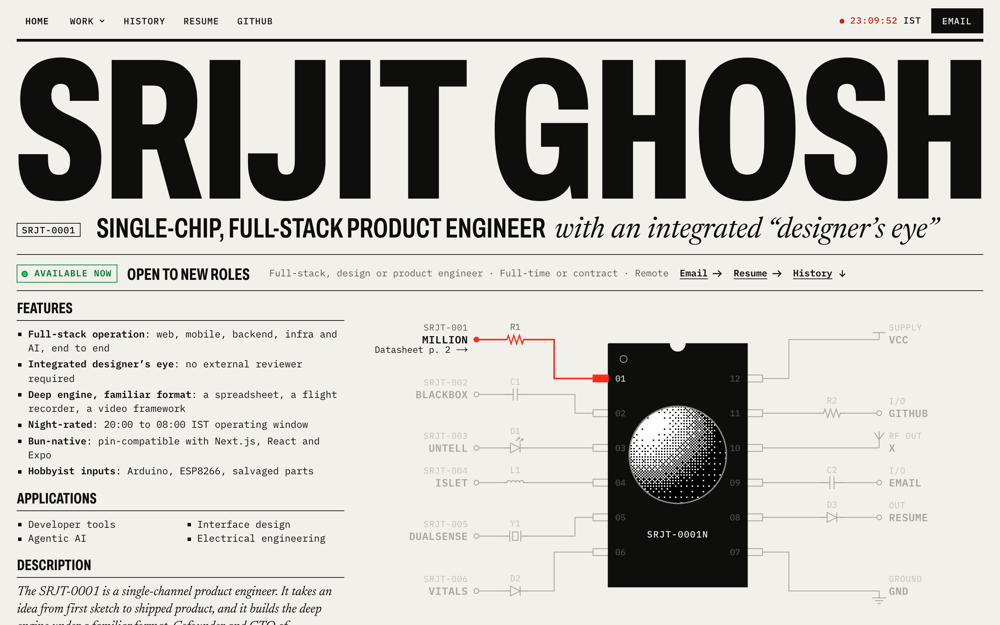
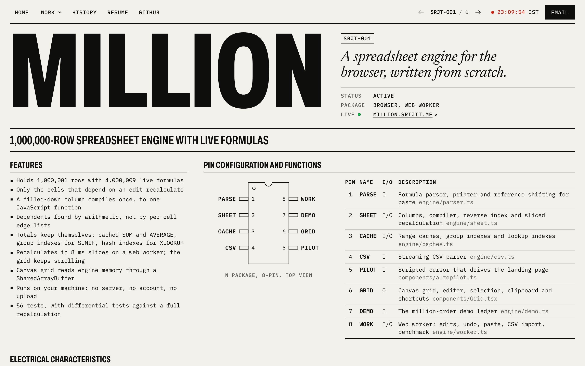
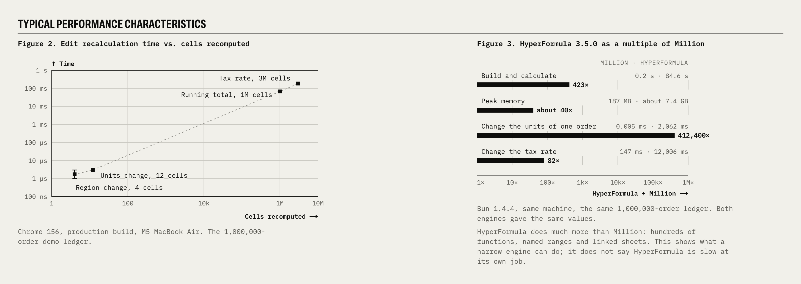
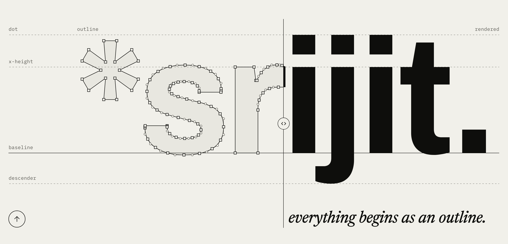
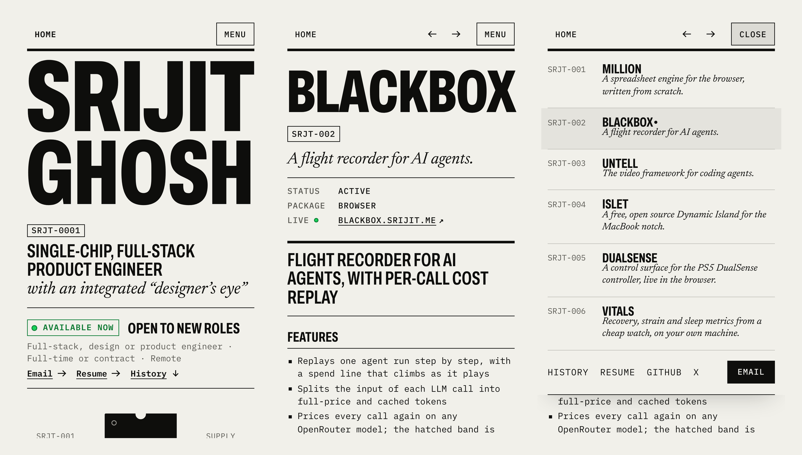

# srijit.me

My personal site, set as an electronic component datasheet. I am the chip, SRJT-0001. Each project is a part in the
catalogue, with its own pinout, electrical characteristics and application circuit.

**Visit it: [srijit.me](https://srijit.me)**

[](https://srijit.me)

Each load starts with a construction drawing of the page. The guides, the wireframes and the letter outlines are
measured from the real page. Then the drawing fades, and the finished page is under it.


## The intro is measured, not keyframed

`lib/construct/scene.ts` reads the page after layout. Each guide sits on a real edge of the page, and each guide label
prints the real pixel value. The name is drawn from the glyph outlines of the built font, at the real pen positions.
`scripts/construct-glyphs.ts` extracts those outlines.

Only the dark layer moves. The page under it is never offset or hidden, so the last frame is the page as the server
sent it. A script in `<head>` puts up the dark canvas before the first paint, so the paper page does not flash first.

- If the app never starts, the script drops the canvas after 3 s.
- Without JavaScript the script does not run, and nothing is hidden.
- Reduced motion, a `#hash` link and a back or forward load get no intro.

A guide label must never sit on a line. `pickSpot()` in `lib/construct/play.ts` tries a set of candidate spots for
each label and keeps the first one that touches no guide and no other label. If no spot is clear at a viewport size,
the dev build logs a warning with that size.

## Every project is a datasheet

[](https://srijit.me/srjt-001)

Each part page has features, a pin table, electrical characteristics, an application circuit and ordering
information. The values come from the project's own README, and the part file in `lib/parts/` names that source. A
value that the README gives as "about" gets a footnote. A part with a live website has a green LED beside its URL.

Million also has performance figures. `components/PerfCharts.tsx` draws them as SVG at 1:1, with one drawing for wide
screens and one for phones.



## The circuits check themselves

Every application circuit has a wide drawing and a phone drawing. `scripts/check-circuits.ts` sets each label in the
metrics of IBM Plex Mono and measures the clear paper around it. It finds a label that is too close to another label,
a wire, a block wall or a symbol, and a label that falls outside the drawing. `bun run build` runs the check first, so
a crowded circuit stops the build. The limits are at the top of the script.

## The footer splits outline from render



The footer sets the name twice: as glyph outlines with their control points, and as rendered type. Drag the line to
move the split. The handle is also a slider for the keyboard. The arrow keys move it by 2%, and Home and End jump to
the ends.

## Phones and paper



On a phone, the chip and the circuits use their own narrow drawings, not scaled copies of the wide ones. The Menu
sheet floats over the page and lists every part. A printed page is a plain A4 datasheet on white paper, without the
site navigation.

## Keyboard

- `J` and `K` go to the next and the previous page.
- `/` opens the list of parts. On narrow layouts it opens the Menu sheet. A second `/` closes it.
- The Up and Down arrow keys move through the open list.
- `Escape` closes the list.

## For crawlers and agents

- `/llms.txt` and `/llms-full.txt` give the site as plain text. They come from the same part files as the pages, so
  the text and the pages cannot drift apart.
- Every page has schema.org JSON-LD: a `Person` on the home page, and `SoftwareSourceCode` with a breadcrumb on each
  part page.
- `app/sitemap.ts` dates each URL from git: the last commit that changed the files that the page's words come from.
  In a shallow clone, git cannot know some dates, so the sitemap leaves them out.
- `proxy.ts` sends a real 404 for an unknown path before the page renders, so a crawler never indexes a soft 404.
- The share cards are rendered from the part data. `scripts/og-die.ts` turns the 1-bit die photo on them into one
  SVG path.

## Analytics without cookies

PostHog counts page views, resume downloads, email clicks and clicks to other sites. It runs in cookieless mode, with
no cookies, no local storage and no session storage, so the site needs no consent banner. It respects Do Not Track.
The events go through `/ingest` on the site itself.

Set these environment variables on the host. Without `NEXT_PUBLIC_POSTHOG_KEY`, the site sends nothing.

- `NEXT_PUBLIC_POSTHOG_KEY`: the project API key. It starts with `phc_`.
- `NEXT_PUBLIC_POSTHOG_REGION`: `us` (the default) or `eu`.

Turn on cookieless server hash mode in the PostHog project, or PostHog drops the events.

## Stack

- Next.js 16 (App Router, Cache Components) and React 19
- TypeScript and Bun
- Plain CSS and SVG, with no CSS framework and no animation library. The intro uses a small spring in
  `lib/construct/spring.ts`.
- Archivo, IBM Plex Mono and Newsreader
- Vercel, with a deploy on each push to `main`

## Run

```bash
bun install
```

```bash
bun run dev
```

Build for production with `bun run build`, then serve with `bun run start`.

## Scripts

- `scripts/check-circuits.ts` checks the spacing of every circuit. Run it alone with `bun run check:circuits`.
- `scripts/construct-glyphs.ts` and `scripts/colophon-glyphs.ts` extract the glyph outlines for the intro and the
  footer from the built font. Run a build first.
- `scripts/og-die.ts` makes the dithered die for the share cards.
- `scripts/favicon.tsx` draws the favicon.
- `scripts/og-samples.tsx` renders sample share cards for review.

## Where things are

| Path | What it holds |
| --- | --- |
| `lib/parts/` | One file for each project, with every value on its datasheet |
| `lib/construct/` | The intro: the scene reader, the player, the spring and the glyph outlines |
| `lib/colophon/` | The geometry and the glyph outlines of the footer |
| `lib/og/` | The share cards and the icon |
| `lib/agent/` | The plain-text views for agents |
| `components/` | The page parts: cover, pinout, datasheet, circuits, charts and navigation |
| `app/` | The routes, the sitemap, robots, the manifest and the share-card routes |

## Fonts

Archivo, IBM Plex Mono and Newsreader are under the SIL Open Font License. Their licence files are in
`assets/fonts/`.
